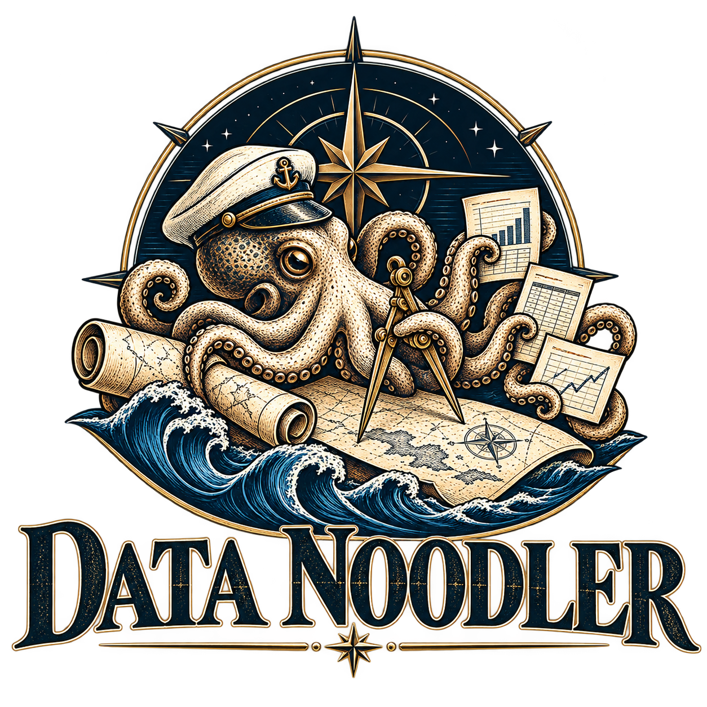

<p align="center">
  
</p>

# Data Noodler

> self-contained flat-file analytics (CSV/Parquet/Arrow/SQLite) with dashboards.

A fully local, self-contained data analytics app for Windows. It runs in Edge or Chrome, is served by the project's
own PowerShell server, and does all of its data work in its own C# engine (no DuckDB, no WebAssembly, no third-party
DLLs, no installs, no admin rights).

## Start

- **First time:** double-click **`Data_Noodler.bat`**. It creates **`Data Noodler.lnk`** in this folder (no admin
  rights), then starts Data Noodler with no console window. `Data_Noodler.bat -NoStart` makes the shortcut only.
- After that, double-click **`Data Noodler.lnk`** (or `Data_Noodler.bat` again).
- Or run `powershell -NoProfile -ExecutionPolicy Bypass -File server\server.ps1`.

The shortcut is made on your computer and is not in git (`*.lnk` is in `.gitignore`), because a Windows shortcut
records the computer's name and your Windows account ID. Every start re-creates it when it is missing and repairs it
when it no longer matches (for example after the folder moved). If Windows Script Host is blocked, only the shortcut
is skipped; Data Noodler still starts.

The server compiles the engine (`server/data-engine/**/*.cs`, cached as a DLL in `temp\data-engine\`) and opens the
**Project Manager**. The red **Server Control** button opens the control panel (port 8079, or 8080/8081 if another program holds it: status, engine check, live log). Starting Data Noodler while it is already running opens the running copy's panel; an older running copy is asked to shut down and replaced. The site port is manual (default 47823) or random in 30000-46999 (edge-ops PORTS.md).

**Settings:** `server/settings.json` holds the tracked defaults and is never written while the tool runs. Changes made in the control panel (port, port mode, browser, theme, engine memory) are saved to `server/settings.local.json`, which is gitignored and overrides the defaults key by key. Delete that file to go back to the defaults.

## How data flows

```
raw file (CSV / Parquet / Arrow / SQLite, copied to data/raw or read in place from X:\ or \\server\share)
   │ Import: column choices applied
   ▼
data/imported/<NAME>/        part-NNNNNN.arrow + dataset.json      ← Arrow IPC: the working format
   │ Transform ── SQL query / script
   ▼
data/clean/CLEAN_<NAME>/   part-NNNNNN.arrow + dataset.json
   │ Dashboard Studio · Publish
   ▼
Export only: Parquet (Snappy) · CSV · SQLite        (Publish, Data Grid export, archives for distribution)
```

- **Arrow on disk, Arrow in memory.** Every dataset is a folder of Arrow IPC files (standard `.arrow`; pyarrow / DuckDB /
  Polars can read them). When a project is opened in a module, its datasets are loaded into engine memory in the
  background and every query (Transform previews, Dashboard widgets, Data Grids, D3 Studio) reads RAM. A dataset that
  changes on disk is reloaded; one too large for the engine's in-memory share is read from its parts instead.
- **Parquet is an export format.** Older projects whose datasets are Parquet keep working; a dataset becomes Arrow the
  next time it is imported or built.
- **Check project classification labels.** Before 2026-10-25, an older project marked `internal` (or with an unknown or
  missing value) was saved as Public. Open each older project in Project Manager and confirm its label.

## Modules

| Module | Page | What it does |
|---|---|---|
| Project Manager | `ui/html/project_manager.html` | Projects (create, edit, rename, trash), module buttons, Update workflow. Entry point. |
| Import | `ui/html/import.html` | Pick or link a raw file, set column names / types, Import it as an Arrow dataset. |
| Transform | `ui/html/transform.html` | Named SQL queries (SELECT or scripts); the active one builds `data/clean/CLEAN_*`. |
| Dashboard Studio | `ui/html/dashboard-studio.html` | Widgets (line, bar, table, custom D3) on a grid; click a widget's Settings > Data and pick table fields; queries run in the engine. |
| Publish | `ui/html/publish.html` | Web app / PDF / PowerPoint / images of a dashboard; dataset export (CSV / Parquet / SQLite). |
| Data Studio | `ui/html/data-studio.html` | The project's workflow as draggable, connectable nodes (Import, Transform, Dashboard, Publish, Archive, Update schedule) (in development). |
| New App | `ui/html/new_app.html` | New home page: workspaces, projects, bookmarks, trash and the Help menu (Server Control, Get Help); opens without a project. |
| Archives | Project Manager > Archives | Zipped project snapshots: take, restore, delete. |
| Benchmark | `ui/html/benchmark.html` (Utilities menu) | Engine speed: imports, exports, reads / writes, heavy queries by rows, batch size and workers. |

## Tests and benchmarks

```
Invoke-Pester -Path .\tests -Output Detailed   # Pester 5: parse check, loopback bind, settings, port block, classification
node --test tests/*.mjs                         # classification migration and menu keyboard tests (Node 18+)
# Engine speed and heavy queries: the Benchmark page (Utilities menu). The engine check scripts that older notes
# mention (.claude/tests) are not in this repository.
```

## Rules for working on it

Changes are listed in `CHANGELOG.md`; open review items are in `NEXT-PASS.md`. The repository does not carry
`CLAUDE.md` or `.claude/docs/` (they are gitignored on the maintainer's machine).

- Windows PowerShell 5.1 only on the server; engine code is C# 5 (compiled by `Add-Type`).
- `.ps1` files are ASCII only.
- Paths are relative to the project root; the site only reads and writes inside it.
- Data files (`*.csv`, `*.parquet`, `*.arrow`, `*.sqlite`, ...) are never committed.
